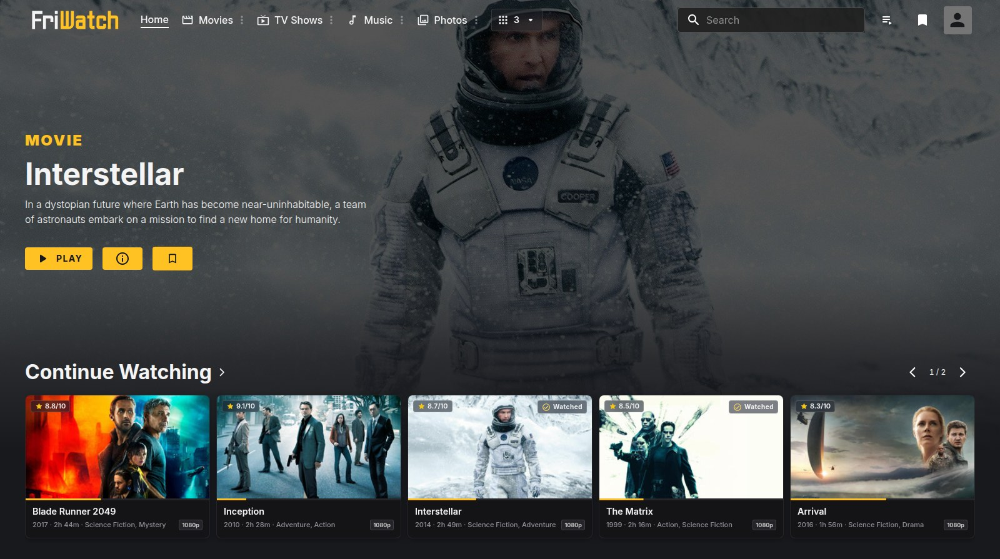

# FriWatch

FriWatch is a self-hosted alternative web interface for Plex Media Server, with movie, TV, music and photo libraries in one responsive browser interface. It includes Plex Home profiles, configurable library browsing, video and music playback, photo galleries, ratings and reviews, and server administration. It runs in Docker and keeps Plex as the media server and source of truth.



## Why FriWatch exists

I was not looking for another side project. I wanted to open Plex and watch a film.

The official web interface had become unreliable in my setup, while the alternatives I tried were either too bare, partially broken, or mixed the basic Plex experience with unrelated accounts, payments, and services. The original Nevu project was the closest match: it already had the right idea and a strong visual foundation, but login, mobile use, playback details, and several everyday workflows still needed work.

FriWatch grew out of that project because watching a film had turned into debugging a media client. It now focuses on a dependable Plex-native experience, practical administration tools, and a codebase that can keep moving forward.

This project is under active development. Expect rough edges, but also expect fixes to target real use rather than a mock interface.

FriWatch originated as a fork of [Ipmake/NevuForPlex](https://github.com/Ipmake/NevuForPlex), maintained under [GPL-3.0](LICENSE) since 2026.

## Features

### Libraries and personal media

- **Plex-native authentication** with Plex Home profile selection, protected-profile PIN entry, and optional profile remembering.
- **Movies and TV** with global search, Continue Watching, recommendations, recently added media and new releases. Title pages include trailers, cast, related titles, extras, and technical media information.
- **Music** with artist and album pages, track lists, and a persistent player that keeps playing during navigation. Edit the Plex queue, shuffle, repeat, or start a playlist from a selected song; reload restores the queue entry and position paused.
- **Photos** with native album browsing, a chronological `All photos` view, filters and sorting. The gallery includes fullscreen viewing, zoom, slideshows and photo information; `My albums` stores personal photo selections as Plex playlists.
- **Configurable library browsing** with standard and advanced filters, watched-state and media-type filters, sorting, adjustable card sizes, and landscape or poster layouts saved per Plex Home profile. TV seasons and movie, TV and music folders have dedicated views; tracks and folders use detailed lists.
- **Plex Watchlist** inside libraries with an optional library filter, search, sorting, and local availability labels; the same view opens the full list from Home.
- **Collections, playlists and personal photo albums** with search, sorting and paged contents. Media menus add items to existing or new lists. Own manual video/music playlists and photo albums support name/description editing, reordering, entry removal and deletion; playlists play in Plex order. Adding to collections follows library management permissions.
- **Personalized navigation** on desktop and mobile, with library pinning, ordering, and optional icons only for each profile. The top bar groups remaining libraries in a compact selector with full names.
- **Ratings and reviews** with personal ratings stored on Plex for video, music and photos. Movie and TV pages show a consistent 0–10 scale with provider labels, critic reviews, individual friend ratings, community reviews with spoiler protection, and writing or editing your own Plex review.
- **Watched-state actions** for movies, shows, seasons and episodes, including selecting multiple episodes to mark played or unplayed together.

### Playback

- **Integrated video playback** with quality selection, audio and subtitle selection and automatic matching, seek previews, intro and credits skipping, resume support, keyboard controls, and optional automatic next-episode playback.
- **Multiple media versions** with combined audio and subtitle lists; choosing a track automatically switches to the file that contains it.
- **Subtitle search, download and file upload** with editable search criteria, language and Forced/SDH preferences, Plex provider results, and automatic selection during playback. Upload SRT, VTT, ASS, SSA or SMI files to the current media version; Plex stores them for future playback.
- **Firefox-compatible trailer playback** with Plex Discover fallback when a local trailer is unavailable.
- **Original-file downloads** for video, tracks and photos when the active Plex account is allowed, with a choice of available files and versions.
- **Watch Together through FriWatch Sync**, which can be disabled for a simpler local installation.

### Administration and hosting

- **Plex Home management** with managed-user names and age restrictions, PINs, household invitations, guest access, member removal, and library permissions, governed by the active profile's Plex permissions.
- **Metadata and artwork administration** through one editor for video, music and photos: type-specific fields, existing-tag suggestions, field locks, supported movie/show editions, and poster/cover/background/logo/square-art/banner editing. Includes uploads, URL imports, music artist/album reassignment, native merge handling, and per-item Plex preferences. Saves preserve unedited values and retain drafts after partial failures.
- **Plex metadata matching** for movies, shows, artists and albums: title or external-ID searches, server-provided agents, and manager-only Match, Fix Match and Unmatch actions. Supports IMDb/TMDB/TVDB IDs and links, plus MusicBrainz artist/release IDs.
- **Plex library administration** for server managers: create, edit, and delete libraries; browse server folders; scan files; refresh metadata; analyze media; and empty library trash.
- **Plex server preferences** generated from the connected server, with grouped sections, search, advanced options, individual defaults, and saving only edited values. Library preferences use the same fields and validation.
- **Library sharing management** for granting, updating, and removing another Plex user's access without leaving FriWatch.
- **Optional native HTTPS** with mounted PEM files or a persistent self-signed certificate.
- **Self-hosted Docker deployment** with reproducible multi-platform images built from lockfiles and published to GHCR.

Global search currently covers movies and TV. Library-wide multiple selection,
smart playlist/collection rule editing, and browsing multiple Plex servers together
remain planned; see the [product roadmap](docs/roadmap.md).

FriWatch is not an official Plex product and is not affiliated with Plex, Inc.

Supported browsers: Chrome 117+, Edge 121+, Firefox 121+, and Safari 17+
(including iOS), following [Material UI's browser requirements](https://mui.com/material-ui/getting-started/supported-platforms/#browser).

## Installation

For a complete installation, use the ready Portainer Stack / Docker Compose example. If Plex already exists, the two Docker commands in the second example are enough. Both variants use the published multi-platform image from GitHub Container Registry.

For all supported environment variables, ports, persistent data, Plex connection options, and TLS mounts, see the [configuration reference](docs/configuration.md).

### Portainer Stack / Docker Compose: Plex + FriWatch

Use this stack for a complete installation:

```yaml
name: friwatch

services:
  plex:
    image: plexinc/pms-docker:latest
    restart: unless-stopped
    ports:
      - "32400:32400"
    environment:
      PLEX_CLAIM: claim-REPLACE_ME
      ADVERTISE_IP: http://192.168.1.10:32400/
    volumes:
      - /srv/plex/config:/config
      - /srv/media:/data:ro

  friwatch:
    image: ghcr.io/dejniel/friwatch:latest
    restart: unless-stopped
    depends_on:
      - plex
    ports:
      - "3000:3000"
    environment:
      PLEX_SERVER: http://plex:32400
    volumes:
      - friwatch-data:/app/data

volumes:
  friwatch-data:
```

Replace the server IP, storage paths, and `PLEX_CLAIM` from [plex.tv/claim](https://www.plex.tv/claim), then deploy:

```bash
docker compose up -d
```

Open Plex at `http://192.168.1.10:32400/web` and FriWatch at `http://192.168.1.10:3000`. The claim token is only needed for Plex's first start.

Timezone, custom Plex user/group IDs, a dedicated `/transcode` mount, hardware acceleration, and additional Plex discovery ports are optional and depend on the host. Add them only when your installation requires them.

### Docker commands: FriWatch with an existing Plex server

When Plex is already running, pull the current FriWatch image:

```bash
docker pull ghcr.io/dejniel/friwatch:latest
```

Then start the container, replacing `PLEX_SERVER` with your server address:

```bash
docker run -d \
  --name friwatch \
  --restart unless-stopped \
  -p 3000:3000 \
  -v friwatch-data:/app/data \
  -e PLEX_SERVER=http://192.168.1.10:32400 \
  ghcr.io/dejniel/friwatch:latest
```

`PLEX_SERVER` must include `http://` or `https://` and must not end with `/`. Open FriWatch at `http://SERVER_IP:3000`.

### HTTPS

FriWatch can use its persistent self-signed certificate or existing mounted PEM files. See the [HTTPS configuration](docs/configuration.md#https) for the exact environment variables and volume mounts.

## Contributing

Bug reports and focused pull requests are welcome. Before implementing a large behavioral or architectural change, [open an issue](https://github.com/Dejniel/FriWatch-Plex-WebUI/issues) so the direction and Plex API assumptions can be discussed first.

Planned product work is tracked in the [product roadmap](docs/roadmap.md).

Good contributions should:

- Preserve compatibility with real Plex Media Server responses rather than relying only on mocked data.
- Include focused tests for authentication, permissions, metadata mutation, or playback-selection logic when those areas change.
- Keep the browser experience usable on both desktop and mobile layouts.
- Avoid committing Plex tokens, private server addresses, generated builds, or local database files.

Even a bug report with browser details, Plex server version, relevant logs, and exact reproduction steps is useful. Development can also be supported through [Buy Me a Coffee](https://buymeacoffee.com/dejniel).

## Development

Requires Node.js 26.10.0 (`.node-version`) and npm 12.2.0; Docker builds use
Buildx/BuildKit. Run the backend and frontend in separate terminals:

```bash
(cd backend && npm ci && \
  PLEX_SERVER=http://192.168.1.10:32400 npm run dev)

(cd frontend && npm ci && npm start)
```

Open `http://localhost:4000`. Vite proxies API, notification, and Watch Together
requests to `http://localhost:3000`; set `FRIWATCH_DEV_BACKEND` to use another backend.
The SQLite install script is pinned and explicitly approved in
`backend/package.json`; review that approval when updating the driver. Settings
use one SQLite table created on first start, without an ORM or migration CLI.

Checks:

```bash
(cd frontend && npm run typecheck && npm run lint && npm test && npm run build)
(cd backend && npm run lint && npm test)
docker buildx build --load -t friwatch:test .
```

TypeScript checks reject unused locals and parameters in both packages.

See the [testing guide](docs/testing.md) for check scope and a standalone Plex
and FriWatch environment.
